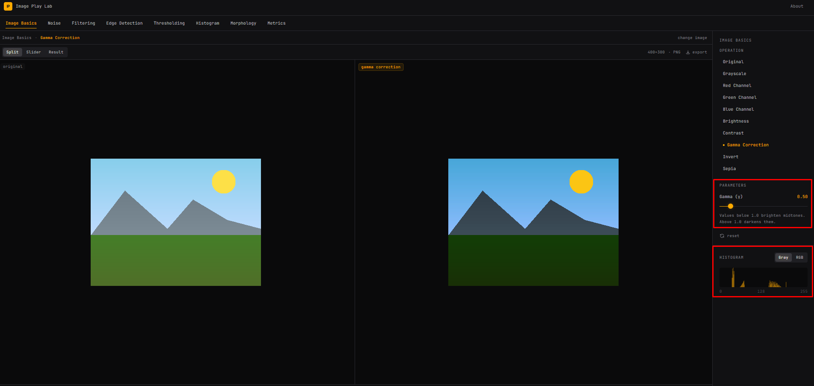
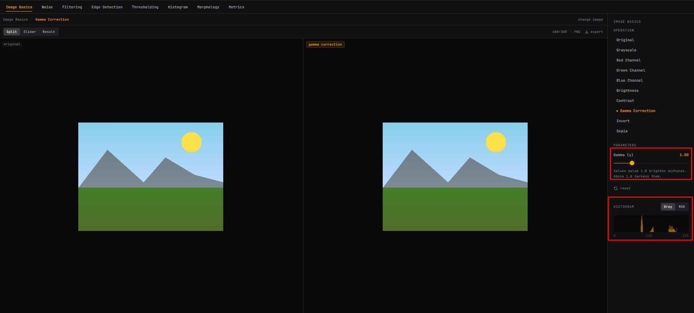
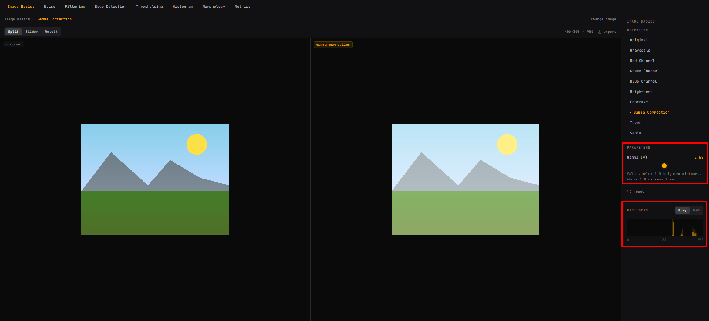

# Завдання 5. Гамма-корекція 

Інструмент: Image Play Lab, зображення Landscape, операція Gamma Correction, режим Split, гістограма Gray.

Формула із завдання: `p_new = 255 · (p / 255)^(1 / γ)`, де γ > 0.

## Прогноз до зміни повзунка

Якщо рухати повзунок Gamma вправо (збільшувати), зображення стане яскравішим і світлішим. Якщо тягнути вліво, картинка стане темнішою.

## Таблиця

| γ | Прогноз до зміни | Розрахунок для p=128 | Що змінилося в зображенні | Що змінилося в гістограмі |
|---|---|---|---|---|
| 0.5 | Темніше | 255 · (128/255)^2 = 64.3 → 64 | Зображення стало темнішим. Гори стали значно темнішими (темно-сіро-синіми). Жовтий колір сонця, блакитний колір неба й зелений колір трави стали насиченішими. | Стовпці зсунулися ліворуч, ближче до 0. |
| 1.0 | Без змін (не вказано окремо) | 255 · (128/255)^1 = 128.0 → 128 | Картинка при γ = 1 ідентична оригіналу. | Гістограма така сама, як в оригіналу. |
| 2.0 | Світліше | 255 · (128/255)^0.5 = 180.7 → 181 | Картинка стала дуже світлою, усі відтінки побіліли: небо блідо-блакитне, гори світло-сірі, трава світло-зелена, сонце майже світло-жовте. | Стовпці зсунулися праворуч, ближче до 255. |

### Знімки екрана

γ = 0.5:

γ = 1.0:

γ = 2.0:

## Перевірка пояснення сервісу

Порівняно три джерела:

1. **Формула із завдання:** `p_new = 255 · (p/255)^(1/γ)`. При γ < 1 показник 1/γ більший за 1, і значення зменшуються (темніше). При γ > 1 показник менший за 1, і значення зростають (світліше).
2. **Вкладка Math у Insights:** «Gamma applies a power curve: out = (in/255)^(1/γ) · 255». Це **та сама формула**, що в завданні, тож ці два джерела узгоджуються.
3. **Підказка під повзунком:** «Values below 1.0 brighten midtones. Above 1.0 darkens them.» Це твердження **суперечить** двом іншим джерелам.

**Суперечність:** підказка каже, що γ < 1 світлить, а γ > 1 темнить. Це правильно для формули з показником γ (`p_new = 255 · (p/255)^γ`), але не для формули `1/γ`, яку сервіс сам показує у вкладці Math.

**Розрахунки:**
- Розрахунок для p = 128: при γ = 0.5 результат 64.3 (темніше за 128), а при γ = 2 результат 180.7 (світліше за 128). Підказка передбачала б протилежне.
- Спостереження: на знімку при γ = 0.5 зображення темніше за оригінал, а при γ = 2.0 світліше. Це збігається з формулою (Math), а не з підказкою.

**Висновок:** вкладка Math, формула із завдання, розрахунок і зображення узгоджуються між собою. Помилковою є лише підказка під повзунком, а саме - вона описує зворотну конвенцію.

## Відповіді на питання

**1. Що відбувається при γ = 1? Чому? Чи змінюються p = 0 і p = 255 при двох інших гаммах?**

При γ = 1 показник 1/γ = 1, тому `p_new = 255 · (p/255) = p`: значення не змінюються, зображення й гістограма збігаються з оригіналом. Для p = 0: (0/255)^(1/γ) = 0, тож p_new = 0 при будь-якому γ. Для p = 255: (255/255)^(1/γ) = 1, тож p_new = 255 при будь-якому γ. Тобто при γ = 0.5 і γ = 2 чорний і білий не змінюються.

**2. Чим гамма-корекція відрізняється від додавання сталої яскравості із завдання 4? Чи однаковою буде зміна для p = 64 і p = 192 при γ = 2?**

Додавання сталої зсуває всі значення на одне й те саме k (з обрізанням до 0–255), а гамма-корекція нелінійна: вона сильніше змінює середні тони, не змінює 0 і 255, а обрізання не потрібне. При γ = 2 (показник 0.5):
- p = 64: 255 · (64/255)^0.5 = 127.75, тобто приблизно 128, зміна +63.75;
- p = 192: 255 · (192/255)^0.5 = 221.27, тобто приблизно 221, зміна +29.27.

Зміна **не однакова**: темніші значення зростають більше, а світліші менше. При додаванні сталої обидва змінилися б на однакове число.

**3. Чи можна за однією гістограмою визначити, де на зображенні розташовані гори?**

Ні. Гістограма показує, скільки пікселів має кожен рівень інтенсивності, але не показує, де саме ці пікселі. Піки гістограми можуть відповідати різним областям (небо, гори, трава), але за самою гістограмою не можна сказати, яка область відповідає якому піку, і тим паче де вона розташована. Різні області з однаковою яскравістю дали б один і той самий пік.

## Висновок

Гамма-корекція змінює значення пікселів нелінійно за степеневим законом: 0 і 255 лишаються на місці, а середні тони світлішають при γ > 1 і темнішають при γ < 1 (за формулою з 1/γ). Для p = 128 при γ = 0.5, 1 і 2 отримано 64.3, 128.0 і 180.7, що збігається зі спостереженнями. Підказка під повзунком у сервісі помилкова, бо суперечить формулі у вкладці Math і результату. Операція не додає нових деталей, а округлення до цілих може об'єднувати різні початкові значення.
